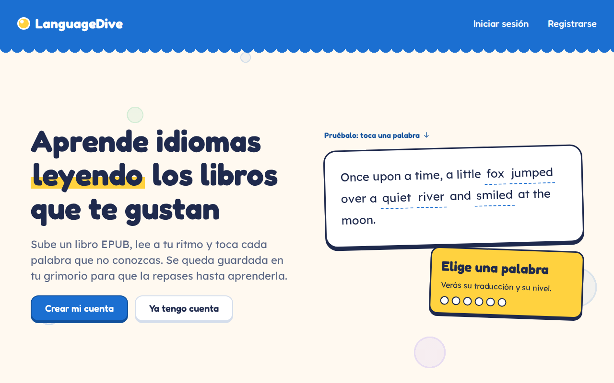
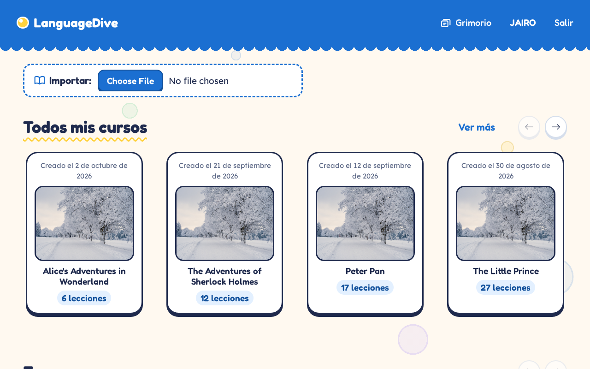
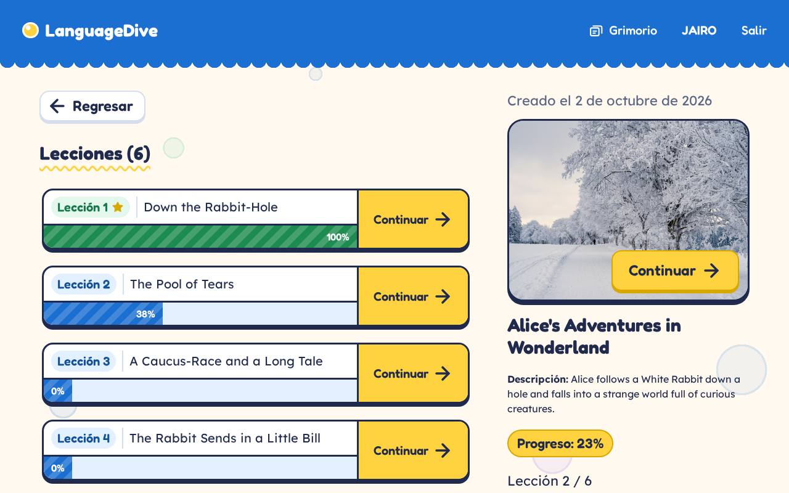
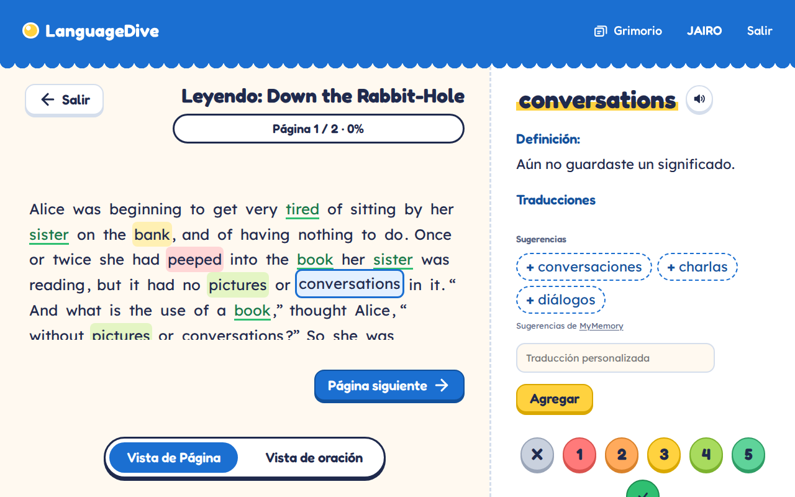
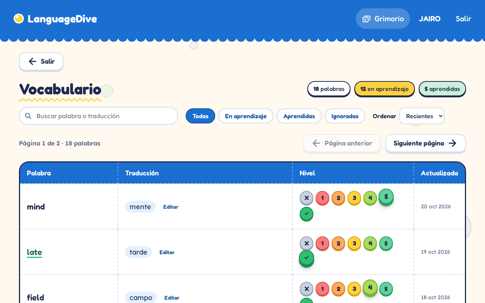

# LanguageDive — Front-end

Interfaz web de **LanguageDive**, una app para aprender idiomas leyendo. El usuario importa libros en formato EPUB, los lee por lecciones y va guardando las palabras nuevas en su vocabulario (el *Grimorio*) mientras avanza.

El front-end consume la API de LanguageDive: `https://languagedive.bryanrodriguez.tech/api`.

## ✨ Funcionalidades

- **Landing**: página de inicio con una demo interactiva de lectura.
- **Cuenta**: registro, inicio de sesión, cierre de sesión y renovación automática del token. La recuperación de contraseña aparece como *Próximamente*.
- **Biblioteca**: importación de libros `.epub` y listado de cursos en tarjetas con paginación y botón *Ver más*.
- **Curso**: detalle del curso con sus lecciones y el progreso de cada una.
- **Lección (lector)**:
  - Vista por oración o por página.
  - Al tocar una palabra se abre un panel para traducirla, elegir su nivel de aprendizaje y escucharla en voz alta.
  - Sugerencias de traducción desde [MyMemory](https://mymemory.translated.net) (servicio gratuito externo).
  - Las palabras se colorean según su nivel.
  - El progreso se guarda automáticamente y se celebra al terminar la lección.
- **Grimorio**: lista de las palabras guardadas con su traducción y nivel.
- **Página 404** propia.

## 📸 Capturas

> Las capturas usan datos de ejemplo (*Alice's Adventures in Wonderland*, de dominio público).

**Landing**



**Biblioteca**



**Curso**



**Lector de lecciones**: al tocar una palabra se abre el panel con sugerencias de traducción y niveles.



**Grimorio**



## 🛠️ Tecnologías

- **HTML**: estructura de las páginas.
- **CSS**: estilos propios, sin frameworks.
- **JavaScript (módulos ES)**: interactividad y consumo de la API, sin dependencias ni paso de compilación.

## 📁 Estructura

```
front-end/
├── pages/                  # La aplicación (raíz del servidor)
│   ├── index.html          # Landing
│   ├── 404.html
│   ├── landing/            # Estilos y script de la landing
│   ├── login/
│   ├── register/
│   ├── forgot-password/
│   ├── library/            # Biblioteca e importación de EPUB
│   ├── course/
│   ├── lesson/             # Lector de lecciones
│   ├── vocabulary/         # Grimorio
│   ├── api-calls/          # Llamadas a la API (auth, cursos, lecciones, progreso, vocabulario, diccionario)
│   ├── assets/             # Imágenes e íconos SVG
│   ├── common.css          # Estilos compartidos (alertas, carga, validación, efectos)
│   ├── alerts.js           # Diálogos de alerta con el estilo de la app
│   ├── loading.js          # Spinners y tarjetas de carga
│   ├── form-validation.js  # Validación de formularios con mensajes propios
│   ├── effects.js          # Confeti y celebraciones
│   ├── auth-scene.*        # Escena y mascota de login y registro
│   └── status-page.*       # Estilos y lógica de las páginas 404 y Próximamente
├── docs/screenshots/       # Capturas usadas en este README
├── wireframes/             # Bocetos de las pantallas
├── index.html / script.js  # Página de prueba de la API
└── README.md
```

## 🚀 Cómo ejecutarlo

Las páginas usan rutas absolutas (por ejemplo `/login/index.html`), así que el servidor debe servir la carpeta **`pages/`** como raíz.

**Con Live Server (VS Code):** abre la carpeta `pages/` como espacio de trabajo y pulsa *Go Live*. El puerto ya está configurado en `pages/.vscode/settings.json` (5503).

**Desde la terminal:**

```bash
npx serve pages
# o
cd pages && python3 -m http.server 5503
```

Luego abre `http://localhost:5503` en el navegador.

## ⚠️ Limitaciones

- **Sugerencias de traducción**: MyMemory permite unos 5.000 caracteres al día por IP. Al pasar el límite dejan de llegar sugerencias, pero se puede seguir escribiendo una traducción propia.
- **Recuperar contraseña**: todavía no funciona; la página solo muestra *Próximamente*.
- **Leer en voz alta**: depende de que el navegador soporte la síntesis de voz y tenga una voz para el idioma del libro.

## 👥 Autores

- **Jairo Cortés Morales**: Frontend · [jairocortes.cloud](https://jairocortes.cloud)
- **Bryan Guadalupe Rodríguez Sánchez**: Backend · [bryanrodriguez.tech](https://bryanrodriguez.tech)

El código del front y del back está en la organización [LanguageDive](https://github.com/LanguageDive) de GitHub.

## 🎨 Wireframes

Los bocetos de las pantallas están en [`wireframes/`](wireframes/). Pueden no coincidir del todo con el diseño final.
